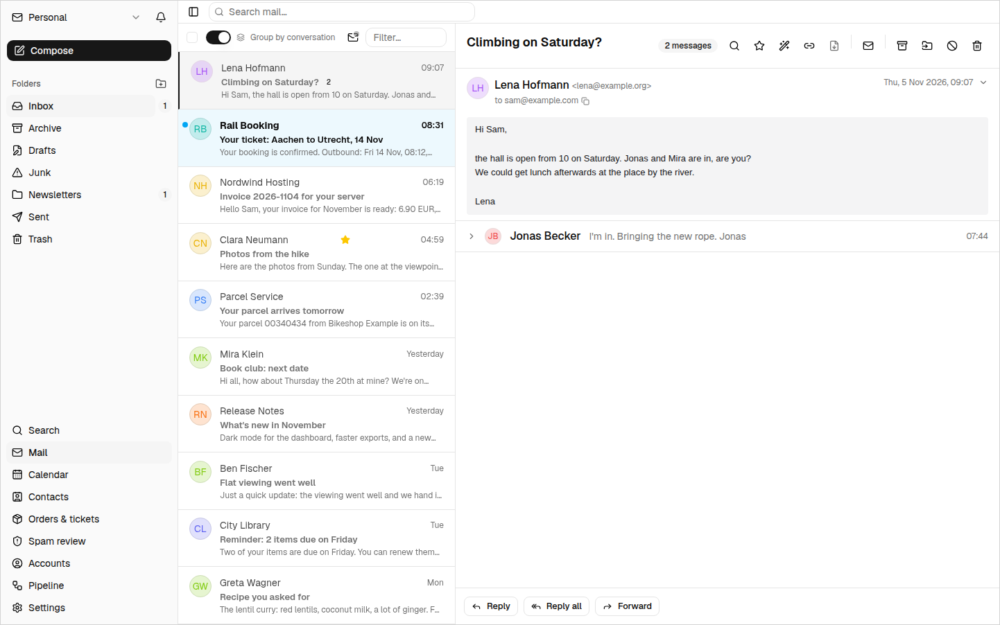
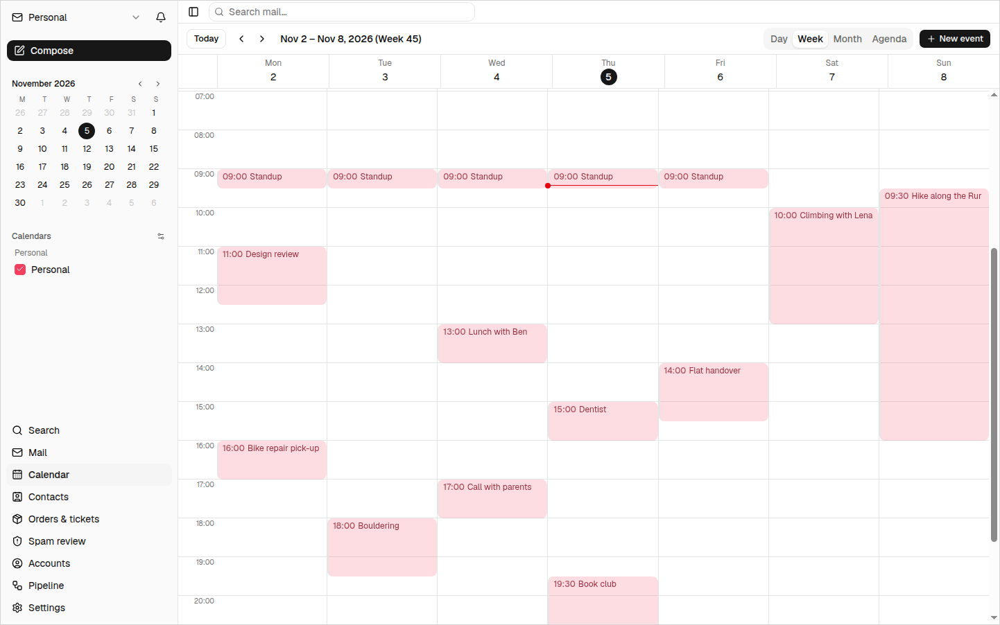
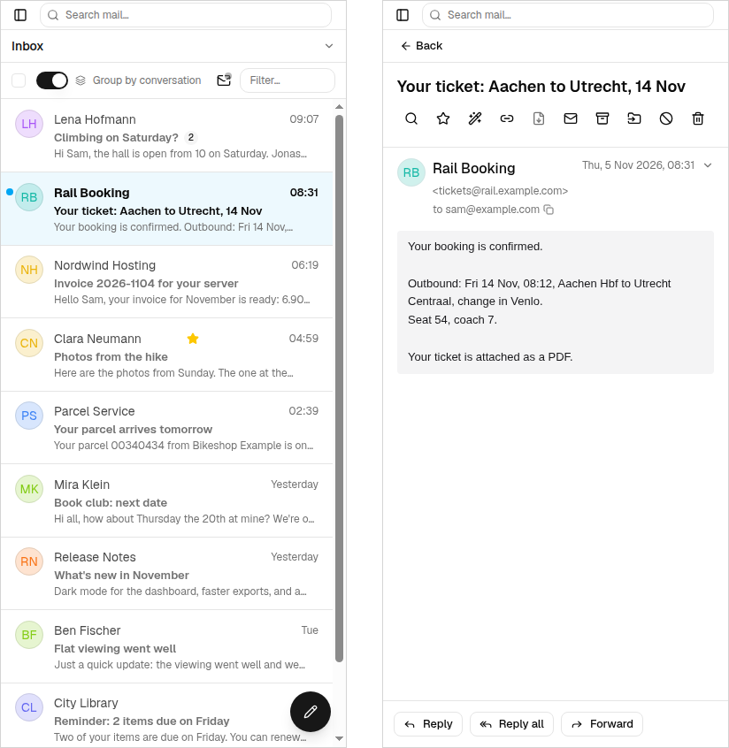

<p align="center">
  
</p>

<table>
<tr>
<td width="100">

</td>
<td>
<h1>MailVerdict</h1>
A self-hosted mail client with an AI layer.
</td>
</tr>
</table>

[](https://github.com/frederikberg/mail-verdict/actions/workflows/ci.yaml)
[](https://github.com/frederikberg/mail-verdict/releases)
[](https://opensource.org/licenses/MIT)

Mail, calendars and contacts from any IMAP, CalDAV and CardDAV server, in one web app you run
yourself. A language model decides what is spam and explains why, bundles the mail about each
order or booking into one entry, and writes rules from a sentence. Plain rules handle the rest.

<p align="center">
  
</p>

## Why

A mail client is mostly the same everywhere. MailVerdict adds what the usual ones don't:

- **Spam verdicts with reasons.** Every new message gets a verdict from a language model, with the
  reasoning shown next to it. A review screen collects every open verdict across all accounts,
  and a wrong one is corrected right from the message.
- **Orders and tickets.** Confirmation, invoice, shipping notice, delivery, return: the mail about
  one purchase or booking becomes one entry with a status and a summary. Attached PDFs, Wallet
  passes and QR codes are read, so a train ticket's code opens full screen, ready to scan.
- **Rules from a sentence.** "These should go to Newsletter too" on an open mail proposes the rule
  change, shows what it would have caught in the last 100 mails, and waits for Accept. Rules can
  also post a message to a webhook.
- **Search by meaning.** Besides ordinary text search, every message has an embedding, so "the mail
  about the broken heater" finds it without the exact words.
- **Glacier storage.** Old mail can leave the mail server for good and live on in MailVerdict's own
  database, still searchable, readable and answerable, and movable back with its flags and date.
- **Mail that behaves.** Undo send held on the server, every action sent exactly once even across a
  flaky connection and a reload, Ctrl+Z for the last few actions, and keyboard shortcuts for the
  everyday ones.
- **Built to be driven by an agent.** A REST API with worked examples, and an MCP server that
  searches, reads, files and sends mail and edits calendars and contacts.

Every feature, area by area: [docs/features.md](docs/features.md).

<p align="center">
  
</p>

## How it fits together

```
browser, iPhone app, MCP client
              │
              ▼
         MailVerdict  →  PostgreSQL  ←  PostIMAP  →  IMAP, SMTP, CalDAV, CardDAV
```

MailVerdict does not speak IMAP. [PostIMAP](https://github.com/frederikberg/postimap) mirrors your
mailboxes, calendars and address books into PostgreSQL in both directions, and MailVerdict is an
ordinary Postgres-backed web app on top of that mirror. Marking a message read is an `UPDATE`;
PostIMAP carries it to the mail server. [docs/architecture.md](docs/architecture.md) explains the
split and everything built on it.

## What you need

- A container runtime (Podman or Docker with compose), or a Kubernetes cluster.
- One or more mail accounts reachable over IMAP and SMTP. Calendars and contacts need a CalDAV or
  CardDAV server, for example Nextcloud.
- An API key for at least one model provider: OpenAI, Anthropic, or any OpenAI-compatible server.
  Without one, mail works and the AI features skip their work until a key is set.
- An authenticating proxy in front of it. MailVerdict has no login of its own ([Access](#access)).

## Run your own

With compose, which brings up MailVerdict, PostIMAP and PostgreSQL together:

```bash
cp .prod.env.example .prod.env      # fill in the secrets, see Configuration
podman compose --env-file .prod.env up -d
```

The UI is then on <http://localhost:8080>. Add an account under *Accounts*; PostIMAP starts
syncing it right away and mail appears as it arrives. Then set a provider key and pick the models
under *Settings*.

On Kubernetes, a Helm chart is published with every release:

```bash
helm install mail-verdict oci://ghcr.io/frederikberg/charts/mail-verdict --version <version>
```

It expects an external PostgreSQL shared with PostIMAP. The
[chart README](charts/mail-verdict/README.md) walks through the three steps — database, PostIMAP,
then MailVerdict — with a CloudNativePG example and the access setup.

For development — hot reload, plus a throwaway mail server and SMTP sink — see
[docs/development.md](docs/development.md).

## Configuration

Every option, with its default and an explanation, lives in
[`config/config.yaml`](config/config.yaml). That file is the documentation; this README does not
repeat it. Configuration comes from that file, then a sparse override file, then environment
variables, and the app refuses to start on anything missing rather than quietly substituting a
fallback.

Anything that changes at runtime is a **setting**, stored in the database and edited on the
Settings page or through the API: the AI providers and models, spam behaviour, rules, and provider
API keys (stored encrypted).

- **One provider and model per AI task:** spam verdicts (`ai`), embeddings (`semantic`), the
  order-matching, order-text and image-reading calls (`orders`' `decide_*`, `write_*` and `read_*`
  keys) and the rule assistant (`assistant`). A provider is OpenAI, Anthropic (not for embeddings,
  it has no embedding model), or any OpenAI-compatible server by its own address, key and model
  name; a custom server's address is set on the task that uses it (`ai.base_url`,
  `semantic.base_url`, `orders.decide_base_url`, ...).
- A key is stored once per provider and shared by every task that names it, so mail that must stay
  private can sit on one provider while order analysis uses another. The Settings page states
  beside each task which mail it reads; [docs/features.md](docs/features.md#privacy) has the
  details.
- A provider that runs out of credit, or rejects its key, pauses its tasks until it answers again,
  and raises an alert if that lasts (`providers.suspended_alert_after_seconds`).
- **Token usage:** the tokens of every paid model response are recorded locally with their
  purpose, provider and model, and pushed to an Elasticsearch data stream once
  `usage_export.elasticsearch_url` is set and an API key for it is stored
  (`elastic_usage_api_key`, written like a provider key). The Settings page shows how the push is
  going.

A handful of values stay environment variables, because they gate config loading itself or are the
fallback for a deployment that would rather not put a key in the database:

| Variable | Purpose |
|----------|---------|
| `ANTHROPIC_API_KEY` / `OPENAI_API_KEY` / `CUSTOM_AI_API_KEY` / `ELASTIC_USAGE_API_KEY` | Fallback provider and usage export keys, used only when nothing is stored via the Settings API |
| `MAIL_VERDICT_DATABASE_URL` | PostgreSQL connection, shared with PostIMAP |
| `POSTGRES_PASSWORD` | Database password, used by compose |
| `ENCRYPTION_KEY` | Encrypts provider keys stored via the Settings API, PostIMAP's own credential-at-rest encryption, and this server's Web Push signing key (generated on first use, never provisioned) — one key shared by all three. Optional; without it, provider keys can only come from the env vars above, and push notifications are unavailable |

## Access

MailVerdict has no login screen and no auth mechanism of its own — nothing checks a header or a
key on any endpoint. Put an authenticating proxy in front of it (OIDC, basic auth, an internal
SSO) and let that handle sign-in. People never touch application credentials, and the app stays
free of session management. The chart README has a worked example.

## On a phone

<p align="center">
  
</p>

The web UI works at phone width and can be installed to the home screen, where it also gets push
notifications.

[mail-verdict-ios](https://github.com/frederikberg/mail-verdict-ios) is a native iPhone client for
the same server. It talks to the same API as the browser, sending whatever credential the proxy in
front of it expects (a bearer token or basic auth).

Its notifications go through a push relay run by the app's publisher, because only the publisher
can sign pushes for the app. Each notification is sealed on this server with a key only the phone
holds, so the relay forwards ciphertext:

- **The relay sees** the phone's device token, this server's IP address, and the size and timing
  of each push.
- **The relay never sees** a subject, a sender, an account, a message or a badge count, and it
  stores nothing.

Native push needs `ENCRYPTION_KEY`. The relays a phone may use are listed in
`push.apns_relay_urls` in [`config/config.yaml`](config/config.yaml). Set it to `[]` to turn native
push off; nothing is then sent to any relay. With the chart's network policy enabled, allow egress
to those relays.

## Docs

- [docs/features.md](docs/features.md): every feature, area by area, and what reaches the model
  provider
- [docs/architecture.md](docs/architecture.md): how MailVerdict and PostIMAP divide the work, live
  updates, the message pipeline, orders, glacier storage, calendars
- [docs/api.md](docs/api.md): the REST API with worked examples, live updates, and the MCP server
  at `/mcp`; the generated OpenAPI document is served at `/api/openapi.json`
- [docs/development.md](docs/development.md): setup, the test layers, running a dev stack,
  releasing
- [charts/mail-verdict/README.md](charts/mail-verdict/README.md): the Helm chart
- [docs/IOS_PARITY.md](docs/IOS_PARITY.md): which web features the iPhone app has

Built with FastAPI, SQLAlchemy and Alembic on the server, React and Next.js on the client, and
FastMCP for the tool interface.

## Known limitations, deliberately

- **Folders can be created and deleted, never renamed or re-nested.** IMAP's rename operation
  renames every child folder along with it, so it can't be mirrored as a single-row update; faking
  it by creating a new folder, moving the mail and deleting the old one would lose flags and
  dates. Deleting a folder destroys every message in it on the server with no undo, so it always
  asks for confirmation naming the message count.
- No multi-user isolation, no offline mode, no PGP.

## License

[MIT](LICENSE) — Frederik Berg
